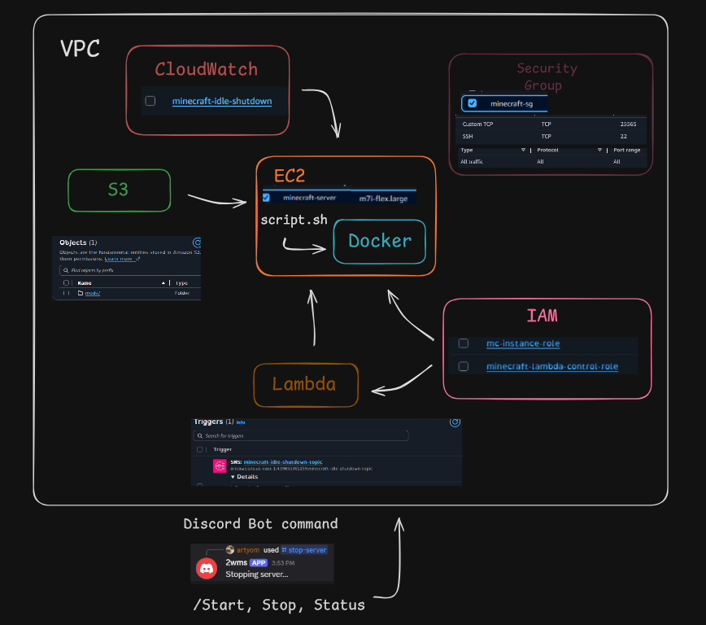

# Minecraft Server on AWS Terraform Infrastructure

This project provisions a complete ***Minecraft server*** on AWS using Terraform. It deploys a modded or vanilla Minecraft server on an EC2 instance with a Discord bot for server control and automatic idle shutdown.

## Architecture Overview

## Modules

| Module | Description |
|--------|-------------|
| **VPC** | AWS VPC with public subnet, Internet Gateway, and route table |
| **Security Group** | Security group allowing Minecraft (25565) and SSH (22) |
| **EC2** | EC2 instance running a Minecraft server using Docker |
| **S3** | S3 bucket storing the modpack |
| **IAM** | IAM roles for EC2 (S3 access) and Lambda (EC2 control) |
| **Lambda** | Lambda function with lambda function url for discord bot interaction |
| **CloudWatch** | CloudWatch alarm for automatic idle shutdown |

# Root Module

### Variables

| Variable | Description 
|--------|-------------|
| `aws_region` | Region where resources are deployed | 
| `ami_id` | Amazon Machine Image ID used to launch the Minecraft server instance | 
| `allowed_role_ids` | Discord role IDs allowed to interact with bot commands | 
| `discord_public_key` | Public key for verifying incoming Discord interaction requests | 
| `instance_type` | AWS EC2 instance type for the Minecraft server | 
| `bucket_name` | Name of the S3 bucket used for storing mods | 

### Outputs

| Output | Description |
|--------|-------------|
| `ec2_public_ip` | Public IP of the Minecraft server |
| `lambda_url` | Lambda Function URL for Discord interactions |

# Discord Bot

The Discord bot lets you control the server from Discord using slash commands. It's deployed as a Lambda function and handles start, stop, and status checks. After setting it up, you'll use the Lambda URL from the outputs as the Interactions Endpoint URL in the Discord Developer Portal.
